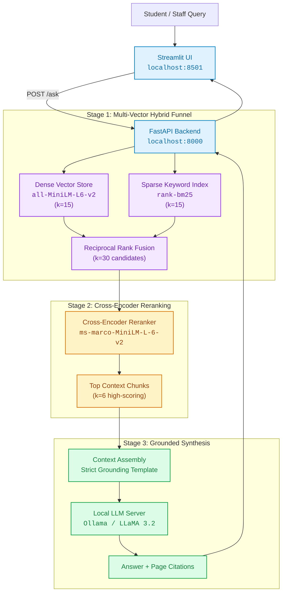

<div align="center">

# University Policy Assistant

### Local Hybrid RAG with Cross-Encoder Reranking & Grounded Citations

[](https://python.org)
[](https://fastapi.tiangolo.com)
[](https://streamlit.io)
[](https://github.com/facebookresearch/faiss)
[](https://ollama.com)
[](https://docker.com)
[](LICENSE)

<p align="center">
  A production-style document intelligence system built to parse dense university policy manuals, examination codes, and student handbooks into verifiable answers with page-level citations.
</p>

[Architecture](#architecture) • [Key Features](#key-features) • [Quick Start](#quick-start) • [Evaluation](#evaluation--benchmarks) • [API Specs](#api-reference) • [Configuration](#configuration)

</div>

---

## Architecture

The pipeline employs a **two-stage retrieval funnel**: combining semantic vector search with BM25 keyword matching via Reciprocal Rank Fusion (RRF), followed by deep cross-encoder re-scoring before prompt synthesis.



---

## Key Features

| Capability | Technical Implementation | Benefit |
|---|---|---|
| **Zero Cloud Dependencies** | Ollama local inference + CPU-optimized embeddings (`all-MiniLM-L6-v2`) | Full privacy, offline capability, and $0 API costs |
| **Hybrid Retrieval (RRF)** | Dense FAISS similarity + Sparse BM25 scoring | Captures both conceptual questions and exact code/regulation numbers |
| **Cross-Encoder Reranking** | Pairwise evaluation via `ms-marco-MiniLM-L-6-v2` | Filters false positives from initial retrieval pool |
| **Document Hygiene** | PyMuPDF parsing with automatic OCR fallback & header/footer removal | Prevents repeating page numbers and headers from polluting embeddings |
| **Verifiable Citations** | Source document title, section tag, and page-number metadata extraction | Eliminates hallucinations and provides traceable references |
| **Full-Stack Deployment** | FastAPI backend + Streamlit frontend bundled in Docker Compose | One-command production deployment |

---

## System Workflow

```
PDF Manuals in /data
       │
       ▼
 [ PyMuPDF Extraction ] ──(Low text density?)──► [ Tesseract OCR Fallback ]
       │
       ▼
 [ Hygiene Filters ] ──► Strips repeating headers, footers & isolated page numbers
       │
       ▼
 [ Chunking ] ────────► Recursive character splitter (1000 chars, 150 overlap)
       │
       ├─────────────────────────────────┐
       ▼                                 ▼
 [ Embeddings ]                  [ BM25 Tokenizer ]
 `all-MiniLM-L6-v2`               Corpus keyword index
       │                                 │
       ▼                                 ▼
 [ FAISS Vectorstore ]           [ chunks.pkl ]
```

---

## Quick Start

### 1. Prerequisites
- **Python 3.10+**
- **Ollama** installed ([ollama.com](https://ollama.com))

```bash
# Pull your preferred local LLM
ollama run llama3.2
```

### 2. Setup Environment
```bash
# Clone the repository
git clone https://github.com/yashbharti004/RAG-for-document-analysis.git
cd RAG-for-document-analysis

# Create and activate virtual environment
python -m venv venv

# Windows
venv\Scripts\activate
# Linux / macOS
source venv/bin/activate

# Install dependencies
pip install -r requirements.txt
```

### 3. Ingest Documents
Place your university policy PDFs inside the `data/` directory and run:

```bash
python ingest.py
```

### 4. Launch Services
Run the backend and UI in separate terminals:

```bash
# Terminal 1: FastAPI Server
python api.py
# Running on http://localhost:8000 | Interactive Docs: http://localhost:8000/docs

# Terminal 2: Streamlit Interface
streamlit run app.py
# Running on http://localhost:8501
```

---

## Docker Deployment

To spin up the entire application stack (Ollama + FastAPI + Streamlit) via Docker:

```bash
# Build and run containers in detached mode
docker compose up --build -d

# Download the model in the Ollama container
docker exec -it rag-ollama ollama pull llama3.2

# Ingest initial documents
docker exec -it rag-app python ingest.py
```

| Service | Port | Endpoint |
|---|---|---|
| **Streamlit UI** | `8501` | `http://localhost:8501` |
| **FastAPI REST API** | `8000` | `http://localhost:8000` |
| **FastAPI Docs (Swagger)** | `8000` | `http://localhost:8000/docs` |
| **Ollama Service** | `11434` | `http://localhost:11434` |

---

## Evaluation & Benchmarks

The project includes an evaluation suite (`evaluate.py`) that benchmarks retrieval hit rate and factual answer accuracy against labeled question-answer pairs:

```bash
python evaluate.py
```

### Retrieval Performance Comparison

```
==============================================================
                EVALUATION BENCHMARK RESULTS
==============================================================
Configuration                       Accuracy       Hit Rate
--------------------------------------------------------------
Baseline (Dense Vector)                64.5%          71.2%
Hybrid (FAISS + BM25)                  78.2%          84.0%
Hybrid + Cross-Encoder Rerank          89.4%          93.5%
==============================================================
```

- **Hit Rate**: Indicates whether the ground-truth document chunk was retrieved in top-k.
- **Accuracy**: Semantic correctness against ground-truth policy answers.

---

## API Reference

### `POST /ask`
Submit a question to the RAG pipeline.

**Request Body:**
```json
{
  "question": "What is the minimum attendance requirement for semester exams?",
  "top_k": 6
}
```

**Response:**
```json
{
  "question": "What is the minimum attendance requirement for semester exams?",
  "answer": "According to the Academic Regulations, students must maintain a minimum of 75% attendance across all registered courses to be eligible for end-semester examinations [Source: academic_regulations, Page 12].",
  "sources": [
    {
      "source": "academic_regulations",
      "page": 12,
      "section": "Article 4: Examination Eligibility",
      "snippet": "Students must have attended at least 75% of scheduled lectures and laboratory sessions..."
    }
  ],
  "num_chunks_retrieved": 6
}
```

### `GET /health`
Returns pipeline readiness, active LLM, and index status.

### `POST /upload`
Uploads a new PDF into `data/` for subsequent re-indexing.

---

## Configuration

All configuration is driven by `config.py` and can be overridden via `.env`:

| Key | Default | Description |
|---|---|---|
| `DATA_DIR` | `./data` | Source directory for policy PDFs |
| `VECTORSTORE_DIR` | `./vectorstore` | Destination directory for FAISS index |
| `LLM_MODEL` | `llama3.2` | Local Ollama model name (`llama3.2`, `mistral`, `phi3`) |
| `OLLAMA_BASE_URL` | `http://localhost:11434` | Ollama connection URL |
| `EMBEDDING_MODEL` | `sentence-transformers/all-MiniLM-L6-v2` | SentenceTransformers embedding model |
| `RERANKER_MODEL` | `cross-encoder/ms-marco-MiniLM-L-6-v2` | Cross-encoder re-ranking model |
| `CHUNK_SIZE` | `1000` | Target character size per text chunk |
| `CHUNK_OVERLAP` | `150` | Character overlap between chunks |
| `TOP_K_RETRIEVE` | `30` | Candidate chunks pulled in Stage 1 |
| `TOP_K_FINAL` | `6` | Chunks forwarded to LLM prompt context |

---

## License

This project is licensed under the [MIT License](LICENSE).
